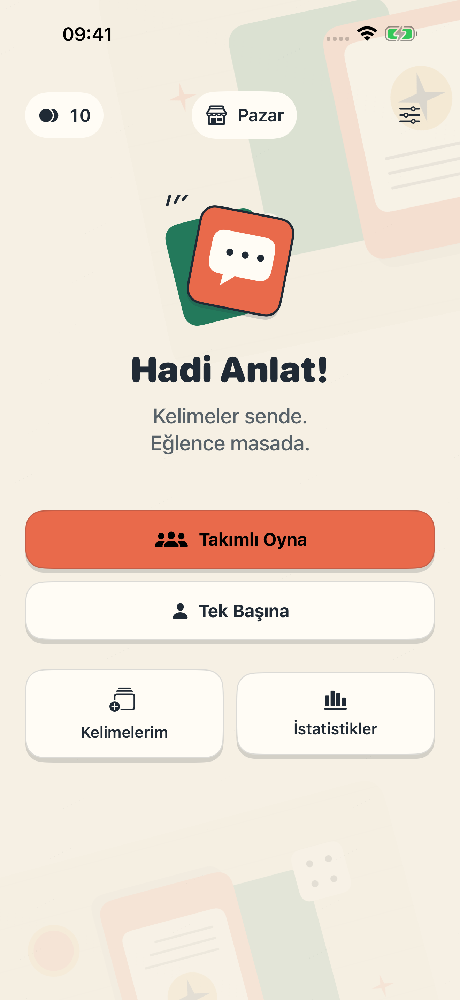
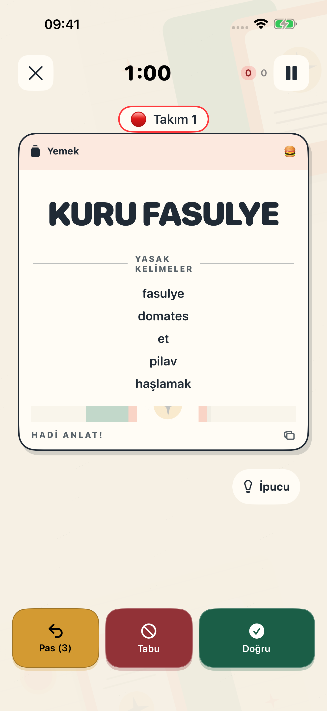
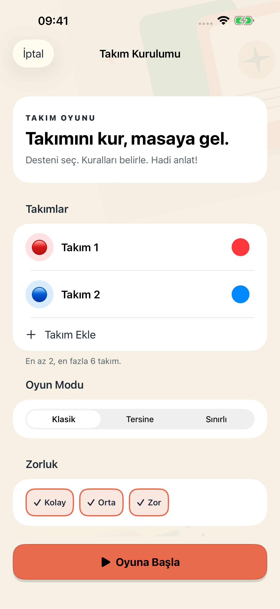

iOS · Kelime oyunu · SwiftUI

<h1 align="center">Hadi Anlat!</h1>

Kelimeler sende. Eğlence masada.

<a href="README.en.md">English</a> · <a href="#ekranlar">Ekranlar</a> · <a href="#geri-bildirim">Geri bildirim</a>

Hadi Anlat!, yasaklı kelimeleri kullanmadan anlatma heyecanını iPhone'a taşır. Arkadaşlarınla takım kur, süreye karşı yarış veya tek kişilik modda kendini dene. Bu depo, uygulamanın herkese açık ürün ve portföy vitrini; uygulama kaynak kodu özel depoda tutulur.

## Ekranlar

  
  
  

Ana menü · Oyun kartı · Takım kurulumu — uygulamadan alınmış iPhone ekranları.

## Oyunu kendi masanıza göre kurun

- **Tek başına veya takımla:** tek kişilik oyun ve 2–6 takımlı, sırayla ilerleyen turlar.
- **Farklı anlatma biçimleri:** klasik, tersine ve sınırlı kelime modları.
- **Kontrol sizde:** kategori, zorluk, tur süresi ve pas kuralları; kaydırma veya düğmelerle kart kontrolü.
- **Kendi kelimeleriniz:** özel kelime ve kategori oluşturma, oyun istatistikleri ve görülen kartların takibi.
- **Yerel kelime destesi:** temel oyun için uygulamaya dahil katalog; tema ve jeton seçenekleri için uygulama içi pazar.
- **iOS'a uyum:** dokunsal geri bildirim, Dynamic Type, VoiceOver ve Reduce Motion desteği.

## Geliştirme yaklaşımı

SwiftUI ve Observation ile arayüz ve durum yönetimi; tek kişilik ve takımlı akışların paylaştığı oyun mantığı; özel kartlar için SwiftData, ayarlar ve istatistikler için yerel kalıcılık. Yerel katalog temel oyunu ağ bağlantısından bağımsız kılar; reklam ve satın alma hizmetleri bağlantı gerektirebilir.

## Kullanılabilirlik

Geliştirme sürümü. Ekranlar mevcut uygulamadan alınmıştır; doğrulanmış mağaza veya dağıtım bağlantısı henüz bu vitrinde listelenmiyor.

## Geri bildirim

Bir sorun veya öneri için [issue açabilirsiniz](https://github.com/Mahmutakin99/Tabu-showcase/issues/new/choose). Kişisel bilgi paylaşmadan cihazınızı, iOS sürümünü ve ilgili ekranı belirtin. Kaynak kod katkısı için bu vitrin bir geliştirme deposu değildir.

Geliştirici: [Mahmut Akın](https://github.com/Mahmutakin99) · [Görsel kökeni](PROVENANCE.md) · [Haklar](NOTICE.md)
